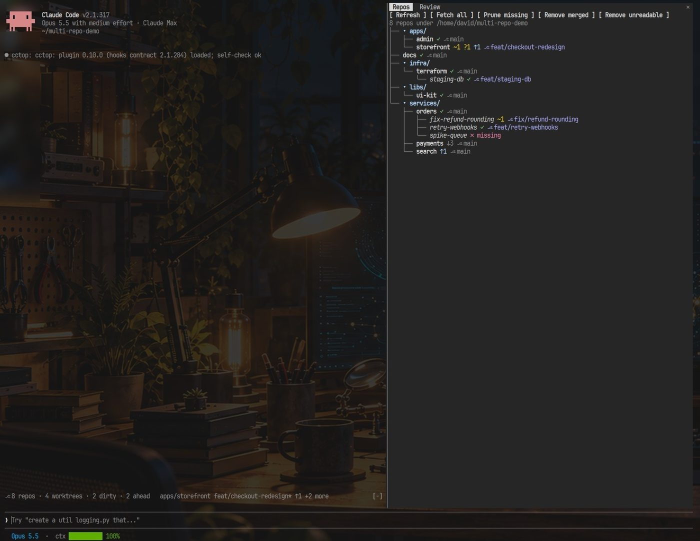
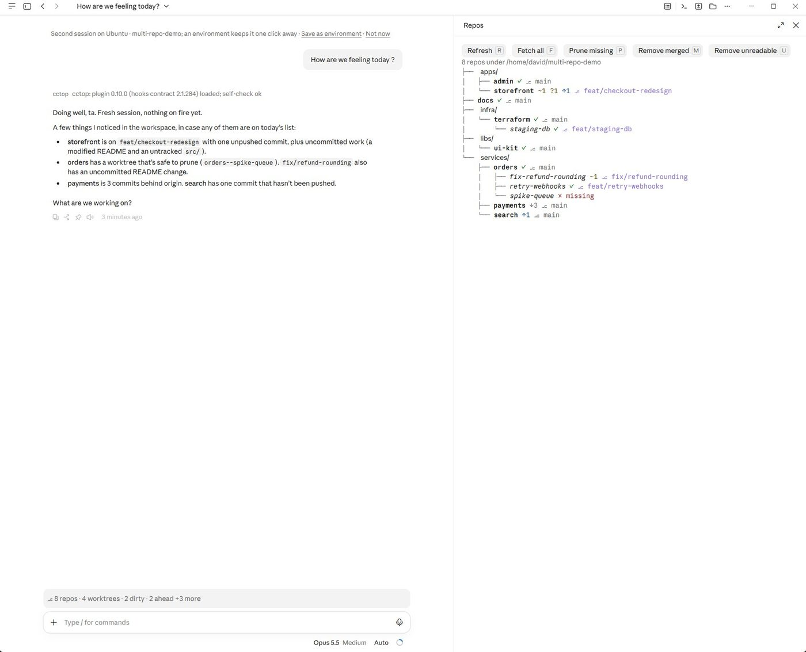

# multi-repo

Git awareness for Claude Code sessions started in a folder that **holds** many git repos, for people who work across them in parallel.



## Overview

When you start Claude Code inside one repo, Claude knows its branch, main branch, status and recent commits. When you start it in a folder of repos, Claude Code sees "not a git repository": no branch in the UI, no git status for Claude, and no hint of how the folder is laid out.

This mod finds every repo under the folder and gives each one that single-repo experience. Linked worktrees are included wherever they live on disk.

| In a single repo, Claude Code has… | With this mod, in a folder of repos |
| --- | --- |
| A `gitStatus` snapshot in Claude's context (branch, main branch, status, recent commits) | A `multiRepoStatus` snapshot covering **every** repo and its worktrees |
| Status that keeps up with your work | Each prompt carries the repos that **changed** since Claude last saw them, and only those |
| Git commands that just work | Guidance in the system prompt: `git -C <repo>`, one commit and PR per repo, parallel work across repos, one worktree per parallel task in the same repo |
| The branch in the UI | A band above the prompt that sums up the workspace, then names the repos with changes, unpushed commits or an unreadable worktree (`▸ api main* · ⎇ 12 repos · 2 worktrees · 3 dirty · 1 ahead   web main* ↑2 +1wt`), and the `/repos` pane, open from the start |

In Claude Code Desktop the pane sits beside the conversation, and Claude answers from the snapshot without running git:

<picture>
  <source media="(prefers-color-scheme: dark)" srcset="docs/images/desktop-dark.jpg">
  
</picture>

## Commands

### `/repos`

Opens the pane, which also opens when the session starts, with every repo drawn as a tree, the way `tree` draws folders. Each repo's linked worktrees hang beneath it, named by their folder less any `<repo>--` prefix. Click a folder in the pane to fold it away (`▸`) or open it again (`▾`). The same tree, without colour or folding, is printed in the transcript.

```
├── apps/
│   ├── admin ✓ ⎇ main
│   └── storefront ~1 ?1 ↑1 ⎇ feat/checkout-redesign
├── infra/
│   └── terraform ✓ ⎇ main
│       └── staging-db ✓ ⎇ feat/staging-db
└── services/
    ├── orders ✓ ⎇ main
    │   ├── fix-refund-rounding ~1 ⎇ fix/refund-rounding
    │   ├── retry-webhooks ✓ ⎇ feat/retry-webhooks
    │   └── spike-queue ✗ missing
    ├── payments ↓3 ⎇ main
    └── search ↑1 ⎇ main
```

| Marker | Meaning |
| --- | --- |
| `✓` | Clean and level with its upstream |
| `+2` `~1` `?1` `!1` | Staged, modified, untracked and conflicted files |
| `↑3` `↓2` | Commits ahead of and behind its upstream |
| `⎇ main` | The branch, or `⎇ @abc1234` when detached |
| `✗ missing` `✗ unreadable` | A worktree whose folder has gone, or that git can't read |

The pane's buttons run one job at a time. While one runs the pane says so, and when it ends a toast says what it did.

| Button | What it does |
| --- | --- |
| **Refresh** (`r`) | Reads every repo's status now |
| **Fetch all** (`f`) | `git fetch --all --prune` in every repo, as `/repos-fetch` does |
| **Prune missing** (`p`) | Clears git's records of worktrees whose folder has already gone (`✗ missing`), with `git worktree prune`. No files are deleted |
| **Remove merged** (`m`) | Offers to remove worktrees whose work is done: clean, nothing unpushed, and the branch already in the main branch |
| **Remove unreadable** (`u`) | Offers to remove worktrees git can't read (`✗ unreadable`), usually because their repo has moved since they were made |

#### What the remove buttons do, and don't

Removing a worktree deletes its folder, so both remove buttons go carefully:

- Nothing goes without asking. The question lists each worktree's full path and its repo. Cancel, or closing the dialog, removes nothing.
- Once you answer, every repo is read again, and only worktrees still in the state you were shown are removed.
- `git worktree remove` does the removing, never with `--force`, so git refuses any worktree with modified or untracked files and leaves it be. Files git ignores, such as build output or a `.env`, go with the folder, and the question says so.
- Branches and commits stay in the repo. Only the checkout goes, and `git worktree add` brings it back.
- The worktree the session is working in is never offered.
- Each removal, and each worktree git kept, is noted in the transcript.

Remove merged counts a branch as merged when its tip is in the main branch, locally or on `origin`. A branch still at the main branch's tip counts as new, and squash merges aren't spotted, so both are left alone. Remove unreadable first runs `git worktree repair`, which only rewrites git's link between the worktree and its repo, so git can check the worktree for changes. Worktrees can live outside the workspace (`~/.cursor/worktrees/…`), and the buttons act on the paths git lists for each repo, wherever they are.

### `/repos-fetch`

Runs `git fetch --all --prune` in every repo, eight at a time. It then refreshes and names the repos whose fetch failed and the ones now behind their upstream.

### The `repo_status` tool

Claude calls `repo_status` for fresh status of one repo (`repo: "services/api"`) or all of them. Claude doesn't have to hand-roll `for d in */; do git -C $d status; done` loops.

## How repos are found

- The scan starts in the folder the session started in. That folder stays the workspace root after `EnterWorktree` moves the session.
- It goes up to **4 levels** down (`scanDepth`).
- It never looks inside a repo it has found. Dependency checkouts inside your repos are never picked up: `node_modules`, `.terraform`, vendored Ansible roles, packages that ship a whole git repo.
- Between the root and your repos, it skips:
  - hidden folders (`.terraform`, `.venv`, `.ansible`, `.cache`, …)
  - folders starting with `_`, such as `_archive`
  - `node_modules, vendor, venv, site-packages, bower_components, Pods, target, dist, build, galaxy_roles, collections`
  - any names you add with `ignore`
- If the starting folder is itself a repo, the mod does nothing: Claude Code's own git support covers that case.

## Worktrees

- Each repo's linked worktrees come from `git worktree list`, so worktrees outside the workspace are listed too: `.claude/worktrees/*` made by `EnterWorktree`, `../api-hotfix`, and so on. Each worktree gets its own branch, changes and ahead/behind, and appears once.
- A folder whose `.git` is a file pointing at `<repo>/.git/worktrees/…` is folded into its main repo. A worktree whose folder has gone is marked prunable. One git can't read (say, its link to the repo is stale) is marked unreadable, and Claude is given git's error.
- A submodule (its `.git` points into `.git/modules/…`) belongs to its parent repo and is not listed on its own.
- The band names the repo or worktree the session is in.

## Settings

Set these in `/config`, or under `pluginConfigs.multi-repo` in settings:

| Setting | Default | What it does |
| --- | --- | --- |
| `scanDepth` | `4` | How many folder levels below the root to search |
| `ignore` | `""` | Extra folder names to skip, comma-separated |
| `showBand` | `true` | Show the band above the prompt: the workspace summary and the repos needing attention |

## Installation

At the prompt of a Claude Code session:

```
/plugin install multi-repo --marketplace farridav/claude-code-recursive-git
```

Answer `y` to add the marketplace, then pick a scope. From a shell:

```
claude plugin install multi-repo --marketplace farridav/claude-code-recursive-git
```

In the desktop app, where `/plugin` does not run: click + next to the prompt box, then Plugins, Add marketplace with `farridav/claude-code-recursive-git`, then Add plugin.

## Requirements

- A Claude Code build where function hooks (mods) are enabled. This API is early access and may change between releases.
- `git` 2.15 or newer, on the `PATH`. Prunable worktrees are flagged by git 2.31 or newer.
- macOS or Linux. Windows paths are untested.

## Troubleshooting

**Nothing appears: no band, no `/repos`.** The mod switches itself off when the session's folder is itself a git repo, or when it finds no repos below it. Start Claude Code in the folder that holds your repos.

**A repo is missing.** It may be deeper than `scanDepth` or inside a hidden or ignored folder. Raise `scanDepth`, or move the repo out of the ignored folder.

**A dependency's repo shows up.** Add its parent folder's name to `ignore`.

**`/repos-fetch` reports failures.** Fetches never prompt for credentials. A repo that needs a password fails until a credential helper or SSH agent can answer for it.

**The status looks stale.** It refreshes after Claude's edits, shell commands and worktree moves, every 60 seconds, and before a prompt once the last scan is 10 seconds old. Press **Refresh** in `/repos` to read it now.

## What it hooks

| Event | What the hook does |
| --- | --- |
| `session.start` | Fixes the workspace root, scans for repos, and, when it finds some, registers `repo_status`, `/repos` and `/repos-fetch`, opens the `/repos` pane and starts the 60-second refresh |
| `session.end` | On `/clear`, forgets what Claude was told, so the new conversation gets a fresh snapshot |
| `prompt.context` | Adds the `multiRepoStatus` block: every repo's branch, main branch, upstream distance, changed files, recent commits and worktrees |
| `prompt.compose` | Adds the `multi-repo:guidance` section on working across repos and worktrees |
| `prompt.section` of `env_info_simple` | Rewrites "Is a git repository" to say the root is a multi-repo workspace |
| `prompt.submit` | Attaches the repos and worktrees whose state changed since Claude last saw them |
| `tool.call` of `repo_status` | Answers with fresh status for one repo or all of them |
| `tool.call` of `Bash`, `Edit`, `Write`, `NotebookEdit`, `EnterWorktree`, `ExitWorktree` | Refreshes 1.5 seconds after the last such call |
| `command.run` of `repos`, `repos-fetch` | Opens the pane and prints the table; fetches every repo |
| `ui.render` of `AbovePrompt` | Draws the band: the workspace summary, then the repos with changes, unpushed commits or an unreadable worktree. Repos only behind their upstream are left to `/repos` |
| `ui.render` of the `multi-repo` `Pane` | Draws the repo and worktree list with Refresh and Fetch all |

The system prompt and the first message's context answer the same way for a whole conversation, so the prompt cache holds. Changes reach Claude only as context attached to later prompts.

## What it calls on `$`

`clock.after`, `clock.every`, `clock.now`, `command.register`, `fs.list`, `fs.read`, `process.run` (git), `session.cwd`, `session.root`, `state.get`, `state.set`, `tool.register`, `ui.ask`, `ui.log`, `ui.open`, `ui.resolve`, `ui.toast`.

## Git commands it runs

Each runs as `git --no-optional-locks -C <repo> …`, in the C locale, with `GIT_TERMINAL_PROMPT=0`. `--no-optional-locks` keeps a background `git status` from taking the index lock, so it never collides with your git commands or Claude's.

| Command | When |
| --- | --- |
| `status --porcelain=v2 --branch --untracked-files=normal` | Every refresh, for each repo and worktree |
| `worktree list --porcelain` | Every refresh, for each repo |
| `log -5 --format=%h %s` | Every refresh, for each repo |
| `symbolic-ref --short refs/remotes/origin/HEAD`, then `rev-parse --verify --quiet refs/heads/main` or `master` | Every refresh, to name the main branch |
| `fetch --all --prune --quiet` | Only from `/repos-fetch` or the pane's Fetch all |
| `worktree prune` | Only from the pane's Prune missing |
| `rev-parse --verify --quiet`, `merge-base --is-ancestor` | Only from the pane's Remove merged, to find merged branches |
| `worktree repair -- <path>` | Only from the pane's Remove unreadable, after you confirm |
| `worktree remove -- <path>` | Only from the pane's Remove merged and Remove unreadable, after you confirm |

Everything else only reads. The fetch is the only command that uses the network, and it runs only when you ask for it.

## Developing

Run it from a checkout:

```sh
claude --plugin-dir /path/to/claude-code-recursive-git
```

| Command | What it does |
| --- | --- |
| `make deps` | Installs the Claude Code CLI version the checks run on (pinned in the Makefile) |
| `make check` | `claude plugin validate .`: the manifest, the marketplace and the hooks module |
| `make test` | `claude plugin test .`: the tests in `tests/`, run against the engine |
| `make smoke` | Builds a scratch workspace of real git repos (worktree, submodule, dependency checkouts, a deep repo) and checks what the scan finds |
| `make typecheck` | `tsc -p .`, once Claude Code has written its API types into `.claude-plugin/types/`, which it does when it loads the mod |
| `make package` | Zips the mod as `dist/multi-repo-v<version>.plugin` |

CI (`.github/workflows/build.yml`) runs `deps`, `check`, `test`, `smoke` and `package` on every push and pull request to `main`. `typecheck` stays local: the API types come from a Claude Code session, and CI has none.

- `hooks/register.tsx` is the hooks module.
- `hooks/git.ts` holds discovery, git parsing and the text Claude reads, as plain functions.
- `types/index.d.ts` is the contract for the values kept in `$.state`.
- Tests are in `tests/`, one file for what each module covers.

## Releasing

1. Bump the version in a pull request: `make version VERSION=x.y.z`.
2. Merge it. [Release Drafter](https://github.com/release-drafter/release-drafter) updates the draft release to `vx.y.z`, with merged pull requests sorted by label (`feature`/`enhancement`, `fix`/`bugfix`/`bug`, `chore`/`dependencies`/`documentation`).
3. Run the **Release** workflow from the Actions tab, rather than publishing the draft by hand. It finds the draft for `plugin.json`'s version, runs the checks and tests, attaches `multi-repo-vx.y.z.plugin` to the draft, then publishes it at the commit it tested.

Releases are immutable once published, so nothing can be added to or swapped in a release afterwards. That's why the file goes on before publishing.

The version lives in `plugin.json` and changes only through pull requests, so CI never pushes to `main`.

## Contributing

Issues and pull requests are welcome: see [CONTRIBUTING.md](CONTRIBUTING.md). Report security problems privately, as [SECURITY.md](SECURITY.md) describes.

## Author

farridav. Released under the [MIT License](LICENSE).
